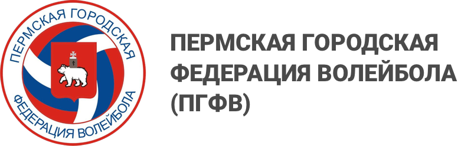
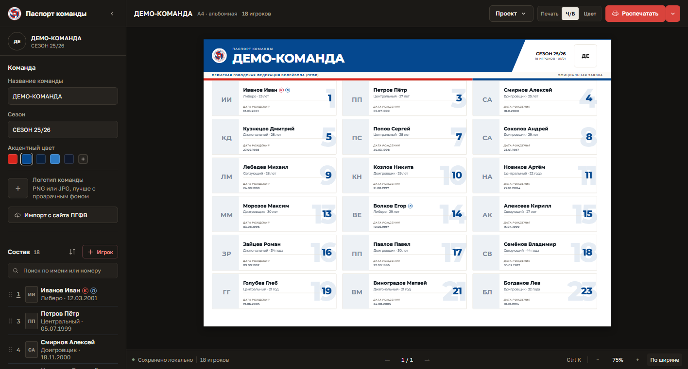

# Паспорт команды — ПГФВ

<p align="center"></p>

Локальное приложение для быстрого создания паспортов команд Пермской городской федерации волейбола: состав, номера, даты рождения, амплуа и фотографии на листах A4. Оформление — в фирменных красно-синих цветах ПГФВ.

В шапке паспорта **всегда есть эмблема федерации** и **место под логотип команды**. Логотип команды загружается в приложении и встраивается в Excel и PDF; фон под ним прозрачный. Если логотип не загружен, на его месте остаётся аккуратная монограмма.



## Быстрый старт

1. Распакуйте папку `team-passport` целиком (важно сохранить структуру папок).
2. Запустите `Открыть паспорт команды.bat`. Он поднимет локальный сервер и откроет приложение в браузере.
3. Интернет нужен только для импорта команды с сайта ПГФВ. Всё остальное работает офлайн.

`index.html` тоже можно открыть двойным кликом, но тогда импорт по ссылке будет недоступен — только HTML-файл.

Подойдёт Chrome, Edge, Яндекс Браузер или другой современный браузер.

## Что умеет

- **Оформление ПГФВ.** Красно-синяя шапка, эмблема федерации, фирменная линейка и акцентные цвета.
- **Логотип команды.** Загрузка PNG/JPG в блоке «Команда» или кликом по квадрату логотипа в шапке листа. Логотип автоматически вписывается в отведённое место, фон под ним прозрачный.
- **Команда.** Название, сезон и акцентный цвет — фирменные оттенки или свой.
- **Капитан и либеро.** Капитан отмечается в карточке — номер подчёркивается, рядом появляется «К». У либеро автоматически появляется «Л» в круге. Капитан в команде один.
- **Пустые поля.** Если номер или амплуа не указаны, они не занимают место в карточке. Под панелью инструментов появляется красная подсказка.
- **Состав до 60 человек.** По 18 игроков на лист, остальные автоматически переходят на следующие листы. Добавление, редактирование, удаление и сортировка по номерам.
- **Импорт со страницы команды.** Данные (имя, дата рождения, фото) и **логотип команды** загружаются с вкладки «Команды» на сайте ПГФВ по ссылке или из сохранённого HTML. Если в названии есть год — например, «Триникс групп 2027», — год убирается из названия и превращается в сезон **26/27**. Подробнее — в `SITE-INTEGRATION.md`.
- **Фотографии.** Загрузка кликом, перетаскиванием на карточку или вставкой из буфера (Ctrl+V). Фото кадрируется по центру под портрет 3:4.
- **Живой предпросмотр.** Лист A4 (альбомная ориентация) выглядит так же, как будущий файл.
- **Печать и PDF.** Главная кнопка «Распечатать» открывает печать; выберите «Сохранить как PDF». По умолчанию печать чёрно-белая; цветная включается отдельным переключателем **«Ч/Б / Цвет»** рядом с кнопкой печати.
- **Экспорт в Excel.** В меню рядом с «Распечатать» — «Excel (.xlsx)» с логотипами, фотографиями, границами и настройками печати.
- **Проект.** «Проект → Скачать проект (.json)» — резервная копия или перенос на другой компьютер. «Загрузить проект» возвращает состав, логотип и настройки.
- **WordPress.** Пошаговая инструкция по размещению на сайте федерации — в `WORDPRESS-INTEGRATION.md` и в файле «Интеграция с сайтом ПГФВ.docx».
- **Автосохранение.** Все изменения хранятся в браузере на этом компьютере.
- **Три режима темы.** Системная, светлая и тёмная — в меню «Проект». Тема меняет только интерфейс; сам паспорт всегда остаётся белым.
- **Работа с большим составом.** Поиск по фамилии, номеру и амплуа, липкая шапка состава, перетаскивание с ручкой и переход по страницам.
- **Командная палитра.** `Ctrl+K` — импорт, добавление игрока, экспорт, темы, страницы и масштаб.
- **Сворачиваемая панель.** Кнопка у названия приложения освобождает место для листа; состояние запоминается.

## Как заполнить паспорт

1. В блоке **Команда** впишите название и сезон. Выберите акцентный цвет.
2. Загрузите **логотип команды**: нажмите на белый квадрат с плюсом в блоке «Логотип команды» или на квадрат с монограммой в шапке листа. Лучше PNG с прозрачным фоном.
3. При необходимости нажмите **Импорт с сайта ПГФВ** и вставьте ссылку на страницу команды — при запуске через `.bat` данные и фото загрузятся автоматически. Подробности — в `SITE-INTEGRATION.md`.
4. В блоке **Состав** нажмите **+ Игрок** или кликните по пустой карточке на листе.
5. Заполните фамилию и имя, номер, дату рождения и амплуа. Добавьте фото.
6. Нажмите **Готово** — карточка сразу появится на листе.
7. Чтобы изменить игрока, кликните по его карточке на листе или по строке в списке.
8. Скачайте **Excel** или **PDF**.

Дата вводится цифрами: `03082004` автоматически превратится в `03.08.2004`.

Амплуа выбирается из списка: Либеро, Центральный, Доигровщик, Диагональный, Связующий. Если нужно своё — выберите «Другое амплуа…» и впишите текст.

## Про Excel

- Лист A4, альбомная ориентация, 3 карточки в ряд и 6 рядов — 18 игроков на страницу.
- До 18 — один лист «Паспорт команды»; больше — отдельные листы «Паспорт 1», «Паспорт 2» и т.д.
- В шапке каждого листа встроены эмблема ПГФВ и логотип команды (или монограмма-заглушка).
- В файл встраиваются фотографии, логотипы, цвета, границы и шрифт Montserrat.
- Настройки печати уже выставлены: «Вписать на одну страницу», поля 6 мм, горизонтальное центрирование.
- Если Montserrat не установлен на компьютере, Excel подставит системный шрифт. Вёрстка при этом сохранится, но вид будет чуть отличаться. Шрифт можно бесплатно установить с Google Fonts.

## Про PDF

Нажмите **«Распечатать»** → в диалоге печати выберите принтер «Сохранить как PDF» (Microsoft Print to PDF / Сохранить в PDF). Не меняйте ориентацию: она задана в стилях — A4, альбомная.

По умолчанию паспорт печатается **чёрно-белым**: белая шапка, чёрная типографика, серые линии. Для цветной версии переключите **«Ч/Б / Цвет»** рядом с кнопкой «Распечатать» и в диалоге печати разрешите печать фона.

## Где хранятся данные

Проект автоматически сохраняется в `localStorage` браузера. Это значит:

- данные остаются на этом компьютере и не отправляются в интернет;
- при очистке данных браузера они пропадут;
- при переносе папки в другое место старые сохранения могут не подхватиться.

Для надёжности периодически делайте **Проект → Скачать проект (.json)**. Этот файл содержит состав, фотографии и логотип команды.

## Ограничения

- До 60 игроков; на один лист помещается 18, остальные автоматически переходят на следующие листы.
- Для фото лучше использовать портрет 3:4, JPG или PNG.
- Для логотипа команды лучше квадратный PNG с прозрачным фоном; JPG тоже поддерживается.
- Демо-состав вымышленный, без фотографий — удобно проверять макет, не используя реальные данные.
- Импорт по ссылке работает при запуске через `.bat` (локальный прокси) или когда приложение размещено на сайте ПГФВ. При открытии `index.html` напрямую остаётся импорт из сохранённого HTML.
- Локальный прокси использует Python; `.bat` находит встроенный или системный Python. Если Python нет, приложение откроется без импорта по ссылке.
- Страница команды на сайте отдаёт имя, дату рождения, фото и логотип команды (featured image). Номера и амплуа на ней не опубликованы — их можно заполнить в приложении.

## Структура папки

```
team-passport/
├─ index.html                  — приложение
├─ css/styles.css              — интерфейс и макет листа в цветах ПГФВ
├─ css/theme.css               — тёмная и светлая темы интерфейса
├─ css/shell.css               — рабочая оболочка: тулбар, статус-бар, страницы
├─ css/fonts.css               — встроенный Montserrat для паспорта
├─ css/ui-fonts.css            — Golos Text для интерфейса
├─ js/app.js                   — логика приложения
├─ js/exporter.js              — сборка Excel с логотипами и несколькими листами
├─ js/site-import.js           — разбор страницы команды ПГФВ
├─ js/theme-init.js            — выбор темы до загрузки CSS
├─ js/brand.js                 — эмблема ПГФВ для Excel (base64)
├─ js/demo-data.js             — вымышленный демо-состав без фото
├─ server.py                   — локальный сервер и прокси для импорта
├─ assets/brand/fed-mark.png   — эмблема ПГФВ
├─ assets/brand/fed-logo.png   — полный логотип ПГФВ
├─ assets/fonts/OFL.txt        — лицензия Montserrat
├─ assets/fonts/GOLOS-OFL.txt  — лицензия Golos Text
├─ assets/fonts/golos-text-*.woff2 — Golos Text
├─ SITE-INTEGRATION.md         — общая схема интеграции
├─ WORDPRESS-INTEGRATION.md    — пошаговая инструкция для WordPress
├─ vendor/exceljs.min.js       — библиотека ExcelJS
├─ vendor/EXCELJS-LICENSE.txt  — лицензия ExcelJS
└─ Открыть паспорт команды.bat — запуск приложения и локального сервера
```

## Технические детали

- Чистый HTML/CSS/JS; для импорта по ссылке используется маленький локальный сервер на Python (`server.py`).
- ExcelJS 4.4.0 (MIT) собирает `.xlsx` прямо в браузере.
- Montserrat (SIL Open Font License) встроен в CSS в виде base64 — поэтому шрифт работает без интернета.
- Фото сжимаются в браузере до 480×640 JPEG, чтобы файл оставался лёгким.
- Логотип команды нормализуется в квадрат 600×600 PNG с прозрачным фоном — поэтому он не искажается в Excel.
- Импорт со страницы команды разбирает `.playerCard__item` (имя, дата рождения, фото), а логотип команды берёт из featured image через REST API ПГФВ; при запуске через `.bat` страница, логотип и фото загружаются через локальный прокси, на сайте ПГФВ — напрямую.
- Эмблема ПГФВ взята с официального сайта [perm-volley.ru](https://perm-volley.ru/) и используется для оформления документов федерации.

## Лицензии

- Montserrat — SIL Open Font License 1.1, текст в `assets/fonts/OFL.txt`.
- ExcelJS — MIT, текст в `vendor/EXCELJS-LICENSE.txt`.
- Эмблема и логотип ПГФВ принадлежат Пермской городской федерации волейбола; используются в паспортах команд федерации.
